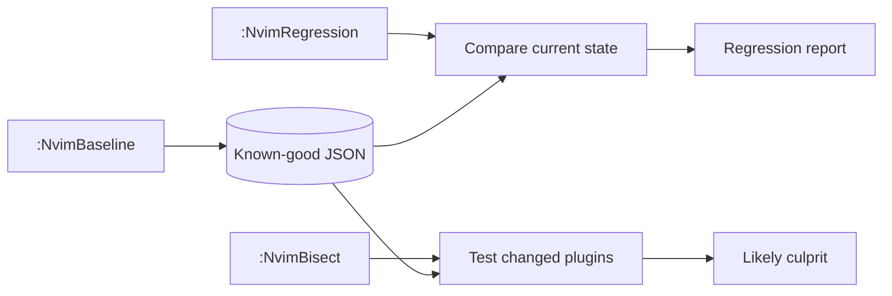

# regression.nvim

[](https://github.com/cctong/regression.nvim/actions/workflows/test.yaml)
[](https://neovim.io/)

`regression.nvim` answers a practical question:

> My Neovim worked before the last update. What changed, and which plugin is
> probably responsible?

It records a known-good snapshot, compares the current session with that
snapshot, and can binary-search changed plugin revisions using clean, headless
Neovim probes.

Plugin-manager operations live behind an adapter. lazy.nvim is the default;
`vim.pack` (Neovim 0.12+) is also supported.

## Requirements

- Neovim 0.10 or newer
- Git
- lazy.nvim, or Neovim 0.12+ with `vim.pack`

## Installation

With lazy.nvim:

```lua
{
  "cctong/regression.nvim",
  config = function()
    require("regression").setup()
  end,
}
```

With `vim.pack`:

```lua
vim.pack.add({ "https://github.com/cctong/regression.nvim" })
require("regression").setup({ adapter = "pack" })
```

For local development:

```lua
{
  dir = "/path/to/regression.nvim",
  config = function()
    require("regression").setup()
  end,
}
```

## Usage

Once Neovim is in a known-good state:

```vim
:NvimBaseline
```

After updating plugins or configuration:

```vim
:NvimRegression
```

The report opens in a scratch split (`q` to close) and includes:

- plugin-manager adapter failures;
- Neovim version changes;
- startup-time regressions;
- new error messages;
- missing or unhealthy LSP clients;
- new `:checkhealth` errors and warnings;
- added, removed, and changed plugin revisions.

If the regression is reproducible and more than one plugin changed:

```vim
:NvimBisect
```

The bisect command temporarily checks changed plugins out at their baseline
revisions, starts clean headless Neovim instances, and narrows the changed set to
one likely culprit. It then bisects that plugin's commits between the baseline
and current revisions. It restores the current revisions before returning.

Use `:NvimBaseline!` to replace an existing baseline.

## Configuration

Defaults are intentionally conservative:

```lua
require("regression").setup({
  profile = "default",
  adapter = "lazy", -- or "pack" for vim.pack
  storage_dir = vim.fn.stdpath("state") .. "/regression.nvim",
  startup = {
    enabled = true,
    percent_threshold = 0.25,
    absolute_threshold_ms = 20,
  },
  health = {
    enabled = true,
  },
  errors = {
    max_messages = 100,
  },
  bisect = {
    timeout_ms = 60000,
    settle_ms = 1000,
  },
})
```

Baselines are JSON files, normally stored at:

```text
stdpath("state")/regression.nvim/default.json
```

Use different `profile` values for separate configurations.

## What bisection means

The command first bisects the **set of plugins changed since the baseline**, then
bisects commits inside the likely culprit from the baseline revision to the
current one. The plugin search assumes one changed plugin is the primary cause.
Interactions between multiple plugins can produce an inconclusive or misleading
answer.

Before changing any checkout, bisection:

1. refuses repositories with uncommitted changes;
2. verifies every baseline commit exists locally;
3. verifies the all-current state is bad in a headless probe;
4. verifies the all-baseline state is healthy;
5. restores all current revisions on success or failure.

The command operates directly on plugin checkout directories. Do not run a
plugin-manager update concurrently with a bisect.

Headless probes reopen the current file and wait up to `settle_ms` for LSP
clients to initialize. Increase this value if your language servers start
slowly.

## Architecture



- `collector.lua` captures editor state without knowing the plugin manager.
- `adapters/lazy.lua` and `adapters/pack.lua` own plugin discovery.
- `git.lua` owns revision checkout operations shared by both adapters.
- `compare.lua` is a side-effect-free snapshot comparison.
- `bisect.lua` owns probe orchestration and guaranteed restoration.
- `store.lua` persists versioned JSON snapshots atomically.

A new plugin manager only needs to implement the adapter contract used by
`adapters/lazy.lua` and `adapters/pack.lua`.

## Testing

```sh
make test
```

The test suite runs in a clean, headless Neovim without external test
dependencies.

## Limitations

- Startup timing runs another default-config Neovim process and is naturally
  noisy; both an absolute and relative threshold must be crossed.
- Error capture uses Neovim's message history and `v:errmsg`; failures that abort
  before this plugin loads are instead caught by bisect probe exit status.
- Health reporting compares individual `:checkhealth` messages when both
  snapshots include them, and falls back to counts for older baselines.
- LSP comparison reflects clients active when the command runs. Run the command
  after the relevant project buffers and clients have loaded.
- Configuration changes are reported indirectly through behavior, but v0.1 only
  bisects plugin revision changes.

## License

MIT
